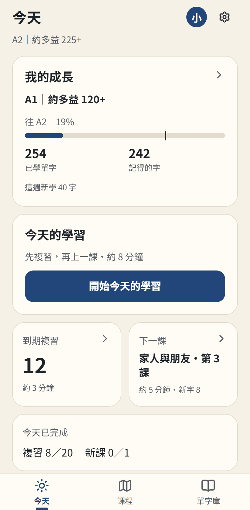
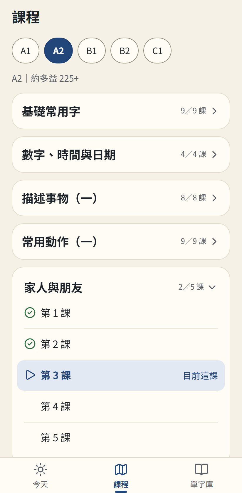
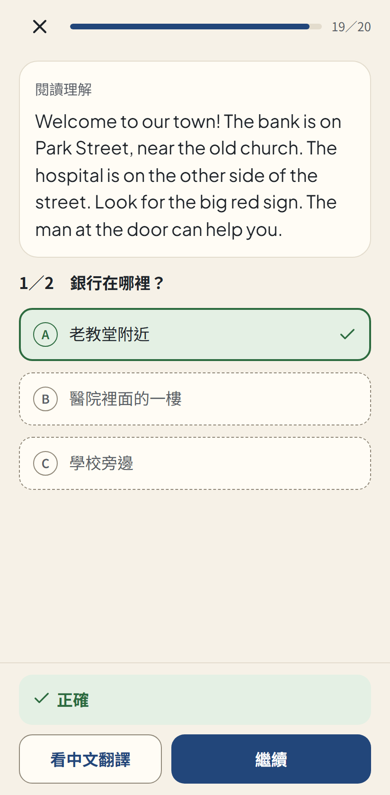
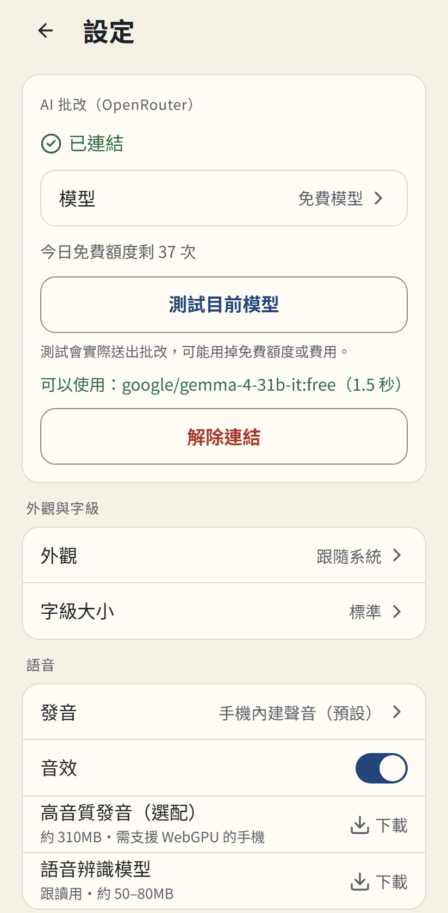

# 拾字（Wordglean）

*Glean a word a day*

給繁體中文使用者的免費英文學習 App，手機瀏覽器打開就能用，不登入也能完整使用。

**立即使用：** <https://wordglean.pages.dev>

| 今天 | 課程 | 小課 | 設定 |
|---|---|---|---|
|  |  |  |  |

## 功能

- **課程：** A1–C1 共 1052 課，含片語課，開始前可做分級測驗。
- **聽說讀寫：** 看字選意、閱讀、聽力、跟讀、中翻英，跟讀錄音不上傳。
- **間隔複習：** 用 FSRS 排程，每天先複習再上新課。
- **點字查義：** 點英文字看音標和中文，可收藏，也能離線使用。
- **AI 批改（選用）：** 連結自己的 OpenRouter 帳號，免費模型會自動切換。寫作批改會把你的句子送到 OpenRouter 上的免費 AI 模型，模型由系統自動選擇。部分提供者可能保留內容或用於訓練，請不要輸入敏感資料。
- **你的資料：** 不登入時只存在手機；用 Google 登入可跨裝置同步。詳見[隱私說明](docs/privacy.md)。

## 快速開始（本機開發）

需要 Node.js 22（見 `.nvmrc`）。

```bash
cd app
npm ci
npm run dev   # http://localhost:5287，用瀏覽器的手機模擬開啟
```

自己架一個站（只有靜態站，或加上 Supabase 登入同步）請見 [自架指南](docs/self-hosting.md)。

## 專案結構

| 目錄 | 內容 |
|---|---|
| `app/` | React＋Vite＋TailwindCSS 手機版 PWA；語音合成、語音辨識、字典、FSRS 都在瀏覽器執行 |
| `content/` | 課綱、題庫 JSON、分級測驗題本，以及產生與檢查它們的程式 |
| `data/` | 單字資料（CEFR-J、Octanove、TSL／NGSL、ECDICT 衍生），依各來源授權分檔 |
| `supabase/` | 資料表、Row Level Security、migrations（登入與同步用） |
| `docs/` | 規格、調查、自架指南、隱私說明 |

## 授權

本專案依內容分成不同的授權範圍，互不混用：

| 範圍 | 授權 |
|---|---|
| 程式碼（`app/`、`supabase/`、`scripts/`，以及 `content/`、`data/` 裡的程式與測試） | [GNU AGPL-3.0](LICENSE) |
| 題庫的題目文字（`content/items/`：例句、選項、短文、翻譯、評分要點） | [CC BY-SA 4.0](https://creativecommons.org/licenses/by-sa/4.0/)；選字與分級依據的來源不在此範圍，各依原授權 |
| 課綱與分級測驗題本（`content/curriculum/`、`content/placement/`） | 依 [`data/LICENSES.md`](data/LICENSES.md) 各來源條款 |
| 單字資料（`data/`） | 依各來源原授權分檔標示：預設 CC BY-SA 4.0（Octanove、TSL、NGSL）；CEFR-J 衍生級距適用 CEFR-J 條款（不是 CC BY-SA）；ECDICT 衍生字典為 MIT。逐檔見 [`data/LICENSES.md`](data/LICENSES.md) |

- 第三方資料、模型與元件的出處與授權見 [`NOTICE`](NOTICE)；App 內「設定 → 隱私說明・授權・原始碼 → 授權與致謝」列出同樣的條目。
- 轉用題目文字時的出處標示方式見 [`content/README.md`](content/README.md)。
- 依 AGPL-3.0，修改本專案的程式並架站給別人使用時，須讓使用者能取得修改後的原始碼。

## 文件索引

| 文件 | 內容 |
|---|---|
| [`docs/spec/requirements.md`](docs/spec/requirements.md) | 產品規格 |
| [`docs/self-hosting.md`](docs/self-hosting.md) | 自架指南：最小部署、Cloudflare Pages＋Supabase、本機模擬 |
| [`docs/privacy.md`](docs/privacy.md) | 隱私說明（與 App 內頁相同） |
| [`CONTRIBUTING.md`](CONTRIBUTING.md) | 開發環境、測試、題庫規則、貢獻的授權 |
| [`NOTICE`](NOTICE)、[`data/LICENSES.md`](data/LICENSES.md) | 第三方出處與逐檔授權 |
| [`content/README.md`](content/README.md) | 課綱與題庫的結構與授權 |
| [`app/CLAUDE.md`](app/CLAUDE.md)、[`supabase/CLAUDE.md`](supabase/CLAUDE.md) | App 指令與測試方式、資料庫規則與欄位對照 |
| [`docs/research/`](docs/research/) | 技術選型與競品調查 |
